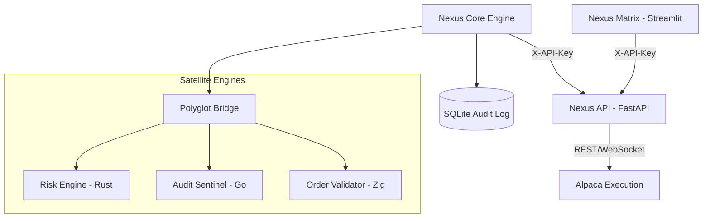

# Alpha-Junior / Nexus Quantitative Research and Paper-Trading Platform

> **Release status: NOT PRODUCTION CERTIFIED.** This repository contains research, paper-trading and execution components, but passing unit tests or starting the services is not proof of live-trading readiness. Before enabling live automation, complete the checklist in [docs/ALPHA_JUNIOR_HARDENING_PLAN.md](docs/ALPHA_JUNIOR_HARDENING_PLAN.md). No return, accuracy, prediction-rate or uptime guarantee is made.

Nexus is an evolving quantitative research and execution platform. Security hardening, broker lifecycle verification, data provenance, model validation and operational certification remain separate release gates.

## 🏛 Architecture

Nexus utilizes a high-performance polyglot architecture (Python, Rust, Go, Zig) with a hardened FastAPI backend and a glassmorphic Streamlit matrix.



## 🛡️ Hardening Features (v2.0)

- **API Security**: Private read and mutation routes require a configured X-API-Key; missing/placeholder keys fail closed. Liveness endpoints are the only unauthenticated routes.
- **CORS**: Browser-origin policy is configured, but CORS is not a substitute for authentication or network controls.
- **Persistence**: SQLite audit and trade-history tables exist. Durable audit-failure gating and backup/restore certification remain release blockers.
- **Signals and models**: Outputs are research signals, not calibrated probabilities; they require leakage-safe out-of-sample validation before promotion.
- **Monte Carlo**: A survival simulation path exists; its assumptions and estimates must be independently validated before risk decisions rely on it.
- **Polyglot components**: Native code is optional/target-dependent and must pass reproducible build and parity tests on each supported operating system.

## 🚀 Deployment

### Prerequisites

- Python 3.11+
- Alpaca API Credentials
- Docker & Docker Compose (Optional, for containerized run)

### Standard Setup

```bash
# 1. Install the portable core/test environment
pip install -r requirements-ci.txt
# For optional GPU, ONNX, and research integrations, select compatible
# platform-specific wheels and review requirements.txt before installing.

# 2. Configure credentials
cp .env.example .env
# Set ALPACA_API_KEY, ALPACA_API_SECRET, and NEXUS_API_KEY

# 3. Verify Hardening
python verify_production_ready.py
```

### Docker Deployment

```bash
docker-compose up --build -d
```

## 📊 Dashboard

The Streamlit matrix provides real-time visibility into:

- **Market Intelligence**: Regime detection, Ensemble agreement, and Quantitative sentiment.
- **Institutional Holdings**: Live P&L tracking from Alpaca.
- **Audit Log**: Real-time compliance monitoring from the GovernanceEngine.

## 💾 Data Lake Quick Start

The new Data Engine (Phase 1) provides a complete pipeline to ingest, validate, and query market data:

```python
from nexus.data.ingestion.yahoo import YahooFinanceSource
from nexus.data.storage.parquet_writer import ParquetWriter
from nexus.data.storage.duckdb_helper import DuckDBHelper
from nexus.data.validation.pipeline import ValidationPipeline
from datetime import datetime

# 1. Ingest Data
source = YahooFinanceSource()
df = source.fetch_historical_ohlcv(["AAPL"], datetime(2023,1,1), datetime(2023,2,1))

# 2. Validate Quality
pipeline = ValidationPipeline()
passed, clean_df = pipeline.validate_batch(df)

# 3. Store as partitioned Parquet
writer = ParquetWriter()
writer.write_ohlcv(clean_df, source="yahoo")

# 4. Query via DuckDB
db = DuckDBHelper()
result = db.query("SELECT symbol, count(*) FROM market_data GROUP BY symbol").df()
print(result)
```

## 🧠 NCM research prototype

A Neural Causal Model research prototype is available at `nexus/research/ncm/`. It accepts an explicit acyclic graph, fits neural mechanisms, supports reproducible interventions, and evaluates a chronological holdout against a mean baseline. It is **offline research only**: it is not connected to the trading ensemble, has no proven prediction advantage, and cannot promote itself or submit orders. See [docs/NCM_RESEARCH_PLAN.md](docs/NCM_RESEARCH_PLAN.md) for the required evidence gates.

## 🛡 Verification & Quality

```bash
# Run the grouped readiness verification (currently eight top-level checks)
python verify_production_ready.py

# Run the test suite
pytest tests/
```

---
> Performance claims should be validated with audited historical and live track records. This platform targets superior risk-adjusted returns but does not promise any specific annualized performance.

**Status:** `NOT_PRODUCTION_CERTIFIED` | **Version:** `2.0.0` | **NCM:** research plan only ([docs/NCM_RESEARCH_PLAN.md](docs/NCM_RESEARCH_PLAN.md))

Use paper/simulation mode until all release gates have passed on the exact commit and deployed environment. Simulation, synthetic prices, a green unit-test result or a backtest is not evidence of live-broker readiness or profitable trading.
